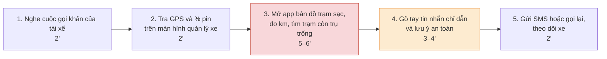
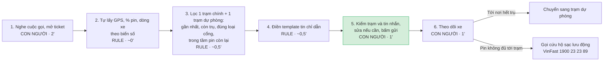

# Báo cáo nhóm — Day 02 Discovery & Problem Framing

> Bản chung của nhóm, viết trên repo do nhóm trưởng fork. Không copy file này sang repo cá nhân.
> Template chi tiết và prompt mẫu: [docs/01-worksheet.md](../../docs/01-worksheet.md). Bài mẫu: [docs/02-deliverable-example.md](../../docs/02-deliverable-example.md).

## 1. Thông tin nhóm

- Tên nhóm: AZEZ
- Thành viên: xem `TEAM.md`
- Candidate problem được chọn (1 câu): Hỗ trợ điều phối viên tra cứu trạm sạc khả dụng và chỉ dẫn an toàn khi xe taxi điện cạn pin khẩn cấp (< 5%) trên đường đón khách.
- Quyết định cuối: Not Yet

---

## 2. Hội tụ nhóm (CP3)

### 2.1. Pitch

| # | Người đưa ra | Candidate (Job Story ngắn) | Actor | Bottleneck | Câu hỏi phản biện nhận được (ai hỏi) |
|---:|---|---|---|---|---|
| 1 | Nguyễn Hoàng Huy | Khi xe sắp hết pin giữa ca, tài xế muốn biết trạm nào còn trụ trống mình được phép sạc | Tài xế Xanh SM | Hết trụ, phải chờ hoặc đổi trạm (ước tính 15–20') | Hưng: Nếu có nhiều tài xế ở gần nhau và đều được điều hướng đến cùng 1 trạm thì có ý tưởng nào để khắc phục tình trạng này không? |
| 2 | Nguyễn Hoàng Huy | Khi đã lên lịch đi chơi, du khách muốn biết trước trò hoặc cáp treo nào đang tạm dừng | Du khách VinWonders / Vinpearl | Đổi kế hoạch tại chỗ (ước tính 15'); thông báo bảo trì không nằm ở trang khách chọn trò | Hưng: Nếu VinWonders đã có hệ thống thông báo bảo trì hoặc tạm dừng trò chơi trên ứng dụng, website và tại cổng vào, vậy nguyên nhân thực sự khiến du khách vẫn không nhận được thông tin là gì? Vấn đề nằm ở thiếu dữ liệu hay cách truyền tải thông tin chưa hiệu quả? |
| 3 | Nguyễn Hoàng Huy | Khi xe đã sạc đầy lúc đang nghỉ, tài xế muốn rời trạm kịp trong 10 phút | Tài xế Xanh SM, chủ xe VinFast | Quay lại xe trễ, phút thứ 11 trở đi tính 1.000 đ/phút | Hưng: Nếu tài xế đang nghỉ ngơi và không chủ động theo dõi điện thoại, việc gửi thông báo khi xe sạc đầy có đảm bảo họ rời trạm trong vòng 10 phút không? Ngoài thông báo, cần có cơ chế nào để hạn chế tình trạng tài xế tiếp tục chiếm dụng trụ sạc? |
| 4 | Nguyễn Công Tĩnh | Khi nhận phản hồi khách hàng, PM muốn phân loại theo nhóm vấn đề để chuyển đúng bộ phận | PM, CSKH Xanh SM | Đọc và phân loại thủ công 1–2'/phản hồi, 50–100 phản hồi/ngày (giả định) | Huy: Nếu áp dụng tự động hóa việc phân loại phản hồi, làm sao để đảm bảo độ chính xác của hệ thống khi các phản hồi của khách hàng thường sử dụng ngôn ngữ không chính thống, từ lóng hoặc diễn đạt không rõ ràng? |
| 5 | Nguyễn Công Tĩnh | Khi có nhiều phản hồi, PM muốn phát hiện các phản hồi cùng nguyên nhân để ưu tiên cải tiến | PM, CSKH | Đối chiếu phản hồi tương tự 20'/lần tổng hợp (giả định) | Huy: Việc đối chiếu thủ công mất 20 phút/lần là một con số giả định, vậy nếu hệ thống tự động tìm ra các nhóm phản hồi tương tự, thì PM có thực sự tiết kiệm được thời gian không, hay vẫn phải mất thời gian xác thực lại các nhóm đó vì máy tính có thể gom nhóm sai logic nghiệp vụ? |
| 6 | Nguyễn Công Tĩnh | Khi CSKH gặp lỗi hệ thống, họ muốn có hướng dẫn xử lý rõ ràng để không phải hỏi kỹ thuật nhiều lần | CSKH, Developer | Chờ developer hướng dẫn 10–20' (giả định) | Huy: Thay vì xây dựng hệ thống hướng dẫn xử lý lỗi (knowledge base) cho CSKH, tại sao không tập trung vào việc tối ưu hóa quy trình báo lỗi hoặc tự động hóa các lỗi thường gặp để CSKH có thể tự xử lý mà không cần đến Developer? |
| 7 | Nguyễn Việt Hưng | Khi đang khám, bác sĩ muốn ghi nhận thông tin lâm sàng nhanh vào hồ sơ bệnh án | Bác sĩ Vinmec | Vừa khám vừa ghi rồi nhập lại vào HIS/EMR; chưa có số phút | Tùng hỏi: "Bệnh án y khoa đòi hỏi độ chính xác tuyệt đối, nếu AI nghe nhầm triệu chứng hoặc bịa liều thuốc (ảo giác) thì bác sĩ soát lại có mất thời gian hơn tự gõ không, và rủi ro pháp lý ai chịu trách nhiệm?" |
| 8 | Nguyễn Việt Hưng | Khi muốn đăng ký khám, bệnh nhân muốn nhanh chóng tìm được chuyên khoa, bác sĩ và giờ phù hợp | Bệnh nhân, tổng đài Vinmec | Xác định chuyên khoa và kiểm lịch trống; chưa có số phút | Tùng hỏi: "Triệu chứng bệnh nhân tự mô tả thường rất mơ hồ (như đau bụng, sốt), nếu AI phân luồng sai chuyên khoa khiến bệnh nhân khám nhầm phòng và trễ điều trị thì xử lý rủi ro an toàn này thế nào?" |
| 9 | Nguyễn Việt Hưng | Khi dùng thuốc tại nhà, bệnh nhân muốn được nhắc đúng giờ và đúng liều | Bệnh nhân sau khám | Tự nhớ lịch uống thuốc; 30–50% bệnh nhân quên liều (khảo sát 127 bệnh nhân, Huế) | Tùng hỏi: "Việc nhắc giờ uống thuốc hiện các app lịch hoặc báo thức điện thoại chỉ cần cài đặt giờ cố định (Rule) là xong, bài này thật sự cần đến AI ở bước nào hay chỉ cần đồng hồ hẹn giờ?" |
| 10 | Trần Thanh Tùng | Khi tài xế taxi điện báo cạn pin dưới 5%, điều phối viên muốn có ngay trạm sạc khả dụng gần nhất kèm chỉ dẫn an toàn | Điều phối viên GSM | Tra trạm còn trụ trống 5–6' + gõ tin nhắn chỉ dẫn 3–4' (phỏng vấn điều phối viên) | Tĩnh: Nếu hệ thống đề xuất trạm sạc gần nhất nhưng trạm đó hết trụ, đang bảo trì hoặc không phù hợp với loại xe, làm thế nào để đảm bảo thông tin đưa ra thực sự chính xác và an toàn cho tài xế? |
| 11 | Trần Thanh Tùng | Khi chuẩn bị nộp bài lab lúc 23h, sinh viên muốn đối chiếu file nộp với rubric | Sinh viên | Đọc dò từng file báo cáo 10–12' (tự bấm giờ 2 lần) | Tĩnh: Nếu AI đánh giá bài làm đã đáp ứng rubric nhưng thực tế nội dung còn sai hoặc thiếu yêu cầu chuyên môn, sinh viên có thể quá tin tưởng vào kết quả AI và nộp bài không đạt chất lượng hay không?|
| 12 | Trần Thanh Tùng | Khi họp nhóm xong, thư ký muốn có danh sách quyết định kèm người phụ trách | Thư ký họp nhóm | Lọc quyết định và chia task 20–25' | Tĩnh: Nếu trong cuộc họp có những quyết định chưa thống nhất hoặc chưa xác định rõ người chịu trách nhiệm, AI sẽ phân biệt đâu là quyết định chính thức và đâu chỉ là ý kiến đề xuất như thế nào? |

### 2.2. Cluster

| Cluster | Các candidate | Pattern chung |
|---|---|---|
| **A — Hạ tầng sạc & Sự cố pin taxi điện** | #1, #3, #10 | Bài toán vận hành năng lượng của đội xe taxi điện GSM: thiếu trụ sạc, phạt quá giờ, và rủi ro cạn pin khẩn cấp khi đang di chuyển trên đường |
| **B — Xử lý phản hồi & Chăm sóc khách hàng** | #4, #5, #6 | Gom nhóm phản hồi của người dùng, phân loại ticket khiếu nại và tra cứu lỗi hệ thống cho nhân viên vận hành |
| **C — Y tế & Chăm sóc sức khỏe** | #7, #8, #9 | Nhập liệu hồ sơ bệnh án điện tử (EMR), tư vấn phân luồng chuyên khoa khám bệnh và quản lý đơn thuốc |
| **D — Hỗ trợ quy trình & Tác vụ cá nhân** | #2, #11, #12 | Thông báo lịch vận hành tiện ích, kiểm tra quy cách nộp bài thực hành và tổng hợp biên bản họp nhóm |

### 2.3. Opportunity Solution Tree rút gọn

Gốc là **1 outcome**. Nhánh là **opportunity** (nhu cầu, pain), không phải tính năng hay công cụ.

```text
OUTCOME: Giảm thời gian xử lý sự cố và giảm thiểu rủi ro xe taxi điện chết máy giữa đường do cạn pin
├── Opportunity A: Điều phối viên mất nhiều thời gian tra cứu phân tán giữa màn hình quản lý xe và app bản đồ trạm sạc
├── Opportunity B: Điều phối viên phải tự gõ tay tin nhắn chỉ dẫn an toàn dễ bị chậm trễ và sót thông số kỹ thuật xe
└── Opportunity C: Tài xế thiếu thông tin trạm sạc dự phòng khi trạm sạc gần nhất bị quá tải hoặc vừa kín trụ
```

Những ý đã gạch bỏ vì là solution đội lốt opportunity:

- ✗ *"Xây dựng chatbot AI tư vấn trạm sạc tự động"* (Solution trá hình, gạch bỏ ở tầng Opportunity)
- ✗ *"Làm Full AI Agent tự động điều hướng xe không cần con người"* (Solution quá phức tạp, vi phạm ranh giới an toàn giao thông)
- ✗ *"Tính năng bản đồ nhiệt trạm sạc theo thời gian thực"* (Feature/tính năng giải pháp, không phải nỗi đau người dùng)

### 2.4. Chấm điểm shortlist (1–5)

| Candidate | Actor rõ | Quy trình rõ | Pain có bằng chứng | Impact đo được | Vừa sức lab | So sánh được No AI/Rule/Workflow/Agent | Nhóm hiểu domain | Tổng |
|---|---:|---:|---:|---:|---:|---:|---:|---:|
| **1. Taxi điện cạn pin khẩn cấp (#10)** | 5 | 5 | 4 | 5 | 5 | 5 | 5 | **34** |
| **2. Phân loại phản hồi CSKH (#4)** | 4 | 4 | 3 | 3 | 4 | 4 | 4 | **26** |
| **3. Ghi chép bệnh án lâm sàng Vinmec (#7)** | 4 | 3 | 4 | 3 | 2 | 3 | 3 | **22** |

**Candidate được chọn:** Hỗ trợ điều phối viên tra cứu trạm sạc khả dụng và chỉ dẫn an toàn khi xe taxi điện cạn pin khẩn cấp (< 5%) trên đường đón khách (#10).

**Vì sao chọn:**
1. **Nghiệp vụ và quy trình cực kỳ rõ ràng:** 5 bước thực tế với 2 bottleneck cụ thể đo lường được bằng phút (5–6 phút tra cứu trạm sạc, 3–4 phút gõ tin nhắn chỉ dẫn an toàn).
2. **Bằng chứng và số liệu xác thực:** Có số liệu phỏng vấn điều phối viên ca trực, đối chiếu trực tiếp với quy trình cứu hộ khẩn cấp 24/7 của VinFast RSA ([vinfastauto.com](https://vinfastauto.com/vn_vi/dich-vu-cuu-ho-xe-dien-vinfast-247)) và chính sách trạm sạc của V-Green ([vgreen.net](https://vgreen.net)).
3. **Phân định ranh giới công nghệ hoàn hảo:** Thể hiện rõ việc dùng Rule để tính toán khoảng cách và lọc trụ trống, dùng AI để soạn nháp câu chữ chỉ dẫn theo ngữ cảnh dòng xe, và bắt buộc duy trì con người kiểm duyệt (Human-in-the-loop). Đây là bài toán mẫu mực cho mức can thiệp **Workflow**.

**Vì sao loại các candidate còn lại:**
- **Loại bài Phân loại phản hồi CSKH (#4):** Nhóm chưa có dữ liệu mẫu thực tế của 50–100 phản hồi, số liệu thời gian chỉ dừng ở mức giả định; ranh giới giữa dùng Rule (gắn tag từ khóa) và AI chưa đủ sắc nét để so sánh sâu 4 mức can thiệp.
- **Loại bài Ghi chép bệnh án Vinmec (#7):** Rủi ro Feasibility và Viability quá cao do liên quan đến quy định pháp lý y tế và dữ liệu bảo mật bệnh nhân (EMR); nhóm không có chuyên môn y khoa để thẩm định chất lượng ghi chép lâm sàng trong phạm vi một buổi lab 4 tiếng.

**Xử lý bất đồng (nếu có):**
Ban đầu bạn Hưng và bạn Tĩnh muốn chọn bài toán CSKH hoặc Y tế vì muốn thử sức với xử lý văn bản phức tạp. Sau khi nhóm cùng rà soát bộ 7 tiêu chí đánh giá, cả nhóm đã thống nhất: Bài toán taxi điện Xanh SM vừa có tính thực tiễn cao, vừa có dữ liệu đối chứng rõ ràng và đảm bảo tính khả thi hoàn thiện trọn vẹn trong buổi lab. Đề tài CSKH được thống nhất đưa vào mục hướng phát triển tiếp theo.

---

## 3. Kiểm chứng + research giải pháp đã có (CP4)

### 3.1. Assumption Map

| # | Giả định | Loại (Value / Usability / Feasibility / Viability) | Quan trọng (1–5) | Đã có bằng chứng (1–5) | Kiểm chứng trước? |
|---:|---|---|---:|---:|---|
| 1 | Khi xe cạn pin dưới 5%, tài xế gọi về tổng đài điều phối, chứ không tự tìm trạm sạc trên ứng dụng | Value | 5 | 1 | ✅ Ưu tiên số 1: nếu sai thì actor "điều phối viên" sai |
| 2 | Điều phối viên khác cũng mất trên 10 phút cho mỗi ca xe cạn pin, không chỉ một người | Value | 5 | 2 | ✅ Mới có số liệu từ 1 điều phối viên (anh N.) |
| 3 | Ca xe cạn pin khẩn cấp xảy ra đủ thường xuyên (3–4 ca mỗi ca trực giờ cao điểm) | Value | 4 | 2 | ✅ Nếu hiếm thì impact nhỏ; mới có 1 nguồn |
| 4 | Bước tốn thời gian nhất là tra trạm còn trụ trống (5–6 phút), không phải nghe máy hay hỏi vị trí | Value | 4 | 2 | ✅ Hỏi cùng giả định #2 |
| 5 | Dữ liệu trụ sạc còn trống theo thời gian thực đã có sẵn và đủ tin cậy để điều phối viên dùng | Feasibility | 4 | 2 | Kiểm bằng research (V-App, ứng dụng tài xế) |
| 6 | Công ty cho phép đưa vị trí xe và dữ liệu vận hành vào công cụ AI | Viability | 4 | 1 | Chưa kiểm được trong buổi lab; hỏi điều phối viên nếu có dịp |

*Bản nháp để nhóm thảo luận: điểm "Quan trọng" và "Đã có bằng chứng" có thể chỉnh. "Đã có bằng chứng" chấm theo nguồn hiện có: 1 = chưa có gì, 2 = mới có 1 người hoặc 1 nguồn.*

Giả định nhóm kiểm chứng trong buổi này: #1, #2, #3, #4 bằng phỏng vấn tài xế Xanh SM và điều phối viên; #5 bằng research giải pháp đã có (mục 3.3).

### 3.2. Kiểm chứng

Cách đã dùng: Phỏng vấn / Survey / Log, ticket, review

Interview snapshot (mỗi buổi phỏng vấn một bảng, hoặc đặt file trong `report/assets/cp4-interview-snapshot-N.md`):

| Trường | Nội dung |
|---|---|
| Người được hỏi (vai trò, không ghi tên thật) | |
| Câu nói đáng nhớ nhất (nguyên văn) | |
| Lần gần nhất gặp vấn đề này: chuyện gì đã xảy ra? | |
| Hiện đang xử lý bằng cách nào (workaround)? | |
| Mất bao lâu, bao lần? | |
| Insight / opportunity rút ra | |

Tổng hợp:

| Nguồn | Số người / số mẫu | Tín hiệu xác nhận | Tín hiệu phản bác |
|---|---:|---|---|
| | | | |

**Nhóm đã sửa problem thế nào sau kiểm chứng:**

### 3.3. Research giải pháp đã có

| Công cụ / case / pattern | Link | Giải bước nào trong quy trình? | Điểm mạnh | Khoảng trống / rủi ro | Bài học cho nhóm |
|---|---|---|---|---|---|
| V-App (V-Green): tính năng gợi ý lộ trình sạc và danh sách phiên sạc, ra mắt 21/05/2026 | [Green SM, 21/05/2026](https://www.greensm.com/vn-vi/news/ra-mat-tinh-nang-moi-goi-y-lo-trinh-sac-va-danh-sach-phien-sac-tren-ung-dung-v-app) | Bước 3 (tìm trạm còn trụ), nhưng ở phía tài xế, không phải màn hình điều phối viên | Có sẵn và gửi thẳng cho tài xế Xanh SM; gợi ý trạm dừng sạc trên tuyến, xem trên bản đồ; theo dõi phiên sạc ở từng trạm (mức pin, thời gian sạc còn lại của các xe đang sạc); trang ghi "theo dõi tình trạng các trụ sạc theo thời gian thực" | Không ghi rõ có hiển thị trụ nào đang trống; điều phối viên vẫn phải mở app này song song với màn hình quản lý xe | Tài xế đã có công cụ tự tìm trạm, nên phải kiểm giả định #1 (tài xế còn gọi tổng đài không). Dữ liệu trạng thái trụ đã tồn tại, giảm rủi ro giả định #5 |
| Dịch vụ cứu hộ pin ô tô điện 24/7 của VinFast (xe sạc lưu động) | [Tuổi Trẻ, 04/05/2022](https://tuoitre.vn/vinfast-trien-khai-dich-vu-cuu-ho-pin-o-to-dien-24-7-20220504115935947.htm) | Bước cuối, khi xe không tự đến được trạm sạc | Gọi hotline 1900 23 23 89, xe sạc lưu động đến tận nơi; 300.000 đ cho mỗi lần sạc cứu hộ tối đa 15 phút, đi thêm khoảng 30 km (VF e34) | Phải chờ xe cứu hộ tới; giá và phạm vi (Hà Nội, Đà Nẵng, TP.HCM và tỉnh lân cận trong 100 km) là thông tin năm 2022, cần kiểm lại; không giải bước tra trạm của điều phối viên | Đây là phương án quay về đã có sẵn khi chỉ dẫn đến trạm thất bại, dùng được cho mục "phương án quay về" ở CP5 |
| Google Maps: hiển thị số trụ sạc còn trống theo thời gian thực (2019) và dự đoán số trụ còn trống khi tới nơi (11/2025) | [9to5Google, 23/04/2019](https://9to5google.com/2019/04/23/google-maps-ev-charging-stations-availability/); [ChannelNews, 20/11/2025](https://www.channelnews.com.au/google-maps-uses-ai-to-predict-ev-charger-availability-before-arrival/) | Bước 3: biết trạm nào còn trụ, và còn trụ khi xe tới nơi | Hiển thị số trụ trống có từ 2019; tính năng dự đoán năm 2025 dùng AI trên dữ liệu thời gian thực | Chỉ hoạt động với mạng sạc chia sẻ dữ liệu cho Google; chưa rõ trạm V-Green ở Việt Nam có trạng thái trụ trên Google Maps không | Pattern: hiển thị trụ trống là việc của Rule khi đã có dữ liệu; AI dự đoán chỉ là lớp thêm sau đó, chưa cần ở giai đoạn này |

**Research cho thấy (để nhóm thảo luận):**

- Phần "tìm trạm còn trụ" đã có công cụ phía tài xế (V-App). Khoảng trống còn lại nằm ở **phía điều phối viên**: phải chuyển qua lại giữa 2 hệ thống, và tự soạn tin chỉ dẫn.
- Nếu phỏng vấn cho thấy tài xế tự dùng V-App mà không gọi tổng đài, actor "điều phối viên" cần được thu hẹp, ví dụ chỉ còn các ca tài xế không tự xử lý được.
- Cứu hộ sạc lưu động của VinFast là phương án quay về sẵn có khi xe không tới được trạm.

*Link trang cứu hộ của VinFast trong báo cáo của Tùng (vinfastauto.com/vn_vi/dich-vu-cuu-ho-xe-dien-vinfast-247) mở bằng trình duyệt ra trang "Page not found" (404). Trang thay thế còn hoạt động: [FAQ chính sách hậu mãi ô tô điện VinFast](https://vinfastauto.com/vn_vi/cau-hoi-thuong-gap/cau-hoi-xe-o-to/chinh-sach-hau-mai), nêu cứu hộ 24/7 qua 1900 23 23 89 và dịch vụ cứu hộ pin khi xe hết pin giữa đường.*

---

## 4. Quy trình trước/sau (CP5)

### 4.1. Quy trình hiện tại

Số phút từng bước lấy từ phỏng vấn điều phối viên vận hành GSM (card #1 trong báo cáo cá nhân của Trần Thanh Tùng). Tần suất: 3–4 ca xe cạn pin khẩn cấp trong một ca trực giờ cao điểm.



| Bước | Actor | Input | Output | Thời gian / tần suất | Ghi chú |
|---:|---|---|---|---|---|
| 1 | Điều phối viên | Cuộc gọi khẩn của tài xế (biển số, mô tả vị trí, mức pin) | Sự cố được ghi nhận | 2' | Handoff: tài xế → điều phối viên |
| 2 | Điều phối viên | Biển số xe | Tọa độ GPS, % pin, dòng xe | 2' | Màn hình quản lý xe (hệ thống 1) |
| 3 | Điều phối viên | Tọa độ, % pin, dòng xe | 1 trạm sạc đích còn trụ trống | 5–6' | **Bottleneck chính**: chuyển qua lại giữa màn hình quản lý xe và app bản đồ trạm sạc (hệ thống 2) |
| 4 | Điều phối viên | Trạm đích, dòng xe, % pin | Tin nhắn chỉ dẫn (địa chỉ trạm, tắt điều hòa, đi chậm) | 3–4' | Bottleneck phụ: gõ tay, dễ sót thông tin |
| 5 | Điều phối viên → tài xế | Tin nhắn chỉ dẫn | Tài xế nhận chỉ dẫn, xe được theo dõi trên màn hình | 2' | Handoff: điều phối viên → tài xế |

Tổng: 5 bước, 14–17 phút mỗi ca, 5/5 bước thủ công.

**Bottleneck chính:** Bước 3, tra trạm sạc còn trụ trống (5–6 phút), vì điều phối viên phải đối chiếu thủ công giữa 2 hệ thống. Bước 4, gõ tay tin nhắn chỉ dẫn (3–4 phút), là bottleneck phụ.

### 4.2. Quy trình tương lai

*Bản nháp để nhóm thảo luận. Số phút ở quy trình tương lai là ước tính, sẽ đo lại khi pilot.*



| Bước | Ai làm | Ghi chú |
|---:|---|---|
| 1 | Con người | Điều phối viên vẫn là người nghe tài xế và đánh giá mức độ khẩn |
| 2 | Rule | Tra cứu theo biển số, không cần AI |
| 3 | Rule | Lọc theo khoảng cách, trạng thái trụ, loại cổng sạc, quãng đường còn đi được; luôn trả về 1 trạm chính + 1 trạm dự phòng |
| 4 | Rule | Template điền sẵn địa chỉ trạm, khoảng cách và lưu ý an toàn theo dòng xe; nhóm chọn Rule ở CP6 (xem mục 6.2) |
| 5 | Con người | **Bước kiểm tra (HITL)**: điều phối viên duyệt trước khi tin nhắn đến tài xế |
| 6 | Con người | Theo dõi xe đến khi cắm được sạc |

**Boundary:**

- Hệ thống không tự gửi tin nhắn cho tài xế; chỉ điều phối viên được bấm gửi.
- Hệ thống không tự gọi cứu hộ và không đưa trạm nằm ngoài danh sách trạm Xanh SM cho phép.
- Tin nhắn chỉ dẫn chỉ dùng thông tin từ dữ liệu xe và trạm; không thêm chỉ dẫn kỹ thuật ngoài danh sách lưu ý an toàn đã duyệt.

**Phương án quay về:**

- Dữ liệu trạm sai hoặc hệ thống lỗi → điều phối viên quay về quy trình thủ công hiện tại (tra app bản đồ trạm sạc, gõ tin theo template giấy).
- Xe tới nơi mà trạm hết trụ → chuyển ngay sang trạm dự phòng đã có trong tin nhắn.
- Pin không đủ để tới trạm nào → gọi dịch vụ cứu hộ sạc lưu động của VinFast (xem mục 3.3).

### 4.3. Before / after

| Chỉ số | Trước | Sau (kỳ vọng) | Ghi chú |
|---|---:|---:|---|
| Số bước | 5 | 6 | Thêm bước 5 kiểm tra và bước 6 theo dõi tách riêng |
| Tổng thời gian | 14–17' | khoảng 5' | Target của card #10: dưới 5 phút mỗi ca |
| Số bước thủ công | 5/5 | 3/6 | Con người vẫn nghe máy, duyệt tin nhắn và theo dõi xe |
| Bottleneck chính | Tra trạm còn trụ trống (5–6') | Điều phối viên kiểm và gửi (1') | Bottleneck mới chấp nhận được vì đây là điểm kiểm soát an toàn |
| Rủi ro mới phát sinh | — | Trạng thái trụ bị trễ, xe tới nơi thì hết trụ; tin nhắn sai loại cổng sạc; điều phối viên tin máy và duyệt lướt | Xử lý bằng trạm dự phòng, boundary và tiêu chí đánh giá ở CP6 |

---

## 5. Problem Statement v0 (CP5)

| Trường | Nội dung |
|---|---|
| **Actor** | **Điều phối viên vận hành GSM** xử lý các ca tài xế Xanh SM báo mức pin khẩn cấp (**< 5%**) và cần hỗ trợ tìm phương án sạc an toàn. Phạm vi v0 tập trung vào những ca tài xế **đã liên hệ điều phối viên / không tự xử lý được bằng V-App**; giả định “tài xế thường gọi điều phối khi pin < 5%” vẫn cần kiểm thêm ở CP4. |
| **Quy trình** | Nhận cuộc gọi khẩn → xác minh biển số, GPS, % pin và dòng xe → đối chiếu thông tin trạm sạc phù hợp → chọn trạm có thể tiếp cận và phương án dự phòng → soạn chỉ dẫn an toàn → gửi cho tài xế và tiếp tục theo dõi. Research cho thấy V-App đã hỗ trợ tài xế gợi ý điểm sạc theo tuyến và theo dõi tình trạng các phiên sạc theo thời gian thực, nên vấn đề v0 không được mô tả là “không có dữ liệu trạm”, mà là **quy trình tra cứu/đối chiếu phía điều phối viên còn thủ công theo bằng chứng phỏng vấn hiện có**. |
| **Bottleneck** | **Bottleneck chính:** bước đối chiếu GPS, mức pin và thông tin trạm sạc giữa các hệ thống mất khoảng **5–6 phút**. **Bottleneck phụ:** điều phối viên tự gõ tin nhắn chỉ dẫn mất thêm **3–4 phút**. Các số liệu này hiện mới dựa trên phỏng vấn một điều phối viên, vì vậy cần tiếp tục kiểm chứng với nhiều ca/người hơn trước khi coi là baseline đại diện. |
| **Impact** | Theo dữ liệu phỏng vấn hiện có, một ca mất tổng cộng **14–17 phút**, trong đó riêng hai bottleneck chiếm **8–10 phút**. Nếu giả định tần suất **3–4 ca/ca trực giờ cao điểm** là đúng, điều phối viên có thể phải dành khoảng **42–68 phút/ca trực** cho các tình huống này. Tác động nghiệp vụ cần giảm là thời gian tài xế chờ hướng dẫn trong khi mức pin đang rất thấp; chưa có dữ liệu đủ để định lượng thêm rủi ro xe dừng hẳn giữa đường. |
| **Success Metric** (baseline → target, cách đo) | **Metric chính:** thời gian từ lúc điều phối viên tiếp nhận ca đến khi gửi được chỉ dẫn đã kiểm tra cho tài xế: **14–17 phút → ≤ 5 phút/ca**. **Metric phụ:** (1) thời gian xác định trạm chính + trạm dự phòng **≤ 1 phút**; (2) **100%** chỉ dẫn phải được điều phối viên kiểm tra trước khi gửi; (3) không đề xuất trạm ngoài danh sách được phép hoặc phương án vượt ngoài tầm pin an toàn. **Cách đo:** dùng timestamp ở ticket/cuộc gọi và thời điểm gửi chỉ dẫn trong pilot, báo cáo median và P90 thay vì chỉ lấy trung bình. |
| **Boundary** (AI không được làm gì; khi nào cần con người kiểm tra — HITL) | Hệ thống **không tự gửi** chỉ dẫn cho tài xế, **không tự gọi cứu hộ**, **không tự quyết định** cho xe tiếp tục di chuyển khi dữ liệu pin/trạm không chắc chắn, **không đề xuất trạm ngoài danh sách Xanh SM cho phép**, và **không tự sinh chỉ dẫn kỹ thuật/an toàn ngoài nội dung đã được phê duyệt**. Điều phối viên phải kiểm tra trạm, tầm pin và nội dung trước khi bấm gửi (**HITL**). Khi trạng thái trạm không khả dụng/không đáng tin hoặc xe không thể tiếp cận trạm an toàn, quay về quy trình thủ công và phương án cứu hộ đã có. VinFast hiện công bố cứu hộ 24/7; dịch vụ cứu hộ pin có điều kiện áp dụng cho tình huống pin rất thấp và không thể tiếp cận nguồn sạc phù hợp. |

Nguồn research dùng để chốt v0:

- Green SM, 21/05/2026 — V-App có “Gợi ý lộ trình sạc” và “Danh sách phiên sạc”; tài xế có thể xem trạm sạc trên tuyến, quãng đường/thời gian ước tính và theo dõi tình trạng các phiên sạc theo thời gian thực: https://www.greensm.com/vn-vi/news/ra-mat-tinh-nang-moi-goi-y-lo-trinh-sac-va-danh-sach-phien-sac-tren-ung-dung-v-app
- VinFast — thông tin cứu hộ: cứu hộ 24/7 qua hotline 1900 23 23 89; FAQ hiện nêu dịch vụ cứu hộ pin cho tình huống xe hết/cạn pin và không thể tiếp cận nguồn sạc phù hợp: https://vinfastauto.com/vn_vi/cau-hoi-thuong-gap/cau-hoi-xe-o-to/chinh-sach-hau-mai

Phản biện nhận được (từ AI hoặc nhóm khác) và nhóm có đồng ý không:

Nhóm đưa Problem Statement v0 cho AI phản biện với yêu cầu chỉ ra lỗ hổng, không viết lại.

| # | Điểm AI chỉ ra | Nhóm đồng ý? | Xử lý |
|---:|---|---|---|
| 1 | Trường Actor vẫn ghi giả định "tài xế thường gọi điều phối khi pin < 5%" là việc cần kiểm ở CP4, trong khi CP4 đã xong | Đồng ý | Cập nhật Actor ở v1 theo kết quả phỏng vấn |
| 2 | Có giải pháp lọt vào Problem Statement: bước "chọn phương án dự phòng" thuộc quy trình tương lai, và metric phụ "xác định trạm chính + trạm dự phòng ≤ 1 phút" đo một tính năng chứ không đo problem | Đồng ý | Bỏ khỏi Quy trình và Success Metric ở v1 |
| 3 | Success Metric chỉ đo tốc độ; gửi chỉ dẫn nhanh nhưng xe vẫn không tới được trạm thì chưa đạt. Metric phụ (2) và (3) giống boundary hơn là metric | Đồng ý | Thêm metric kết quả ở v1 (ví dụ tỉ lệ ca xe tới được trạm và sạc được); chuyển (2), (3) sang Boundary |
| 4 | Trường Quy trình và Boundary chứa phần research (V-App, cứu hộ VinFast) thay vì mô tả problem | Đồng ý | Giữ research ở mục 3.3 và phần "Nguồn research", rút gọn các trường ở v1 |
| 5 | Các trường quá dài, khó đọc nhanh | Đồng ý | Viết lại mỗi trường trong 1–3 câu ở v1 |

---

## 6. Mức can thiệp AI (CP6)

### 6.1. Ma trận độ mơ hồ × độ phức tạp

Bài của nhóm nằm ở ô: **Độ mơ hồ thấp × độ phức tạp trung bình** (giữa "Rule hoặc Workflow đơn giản thường đủ" và "Workflow nhiều bước rõ ràng, chưa chắc cần Agent").

Vì sao:

- **Độ mơ hồ thấp:** đầu ra có đúng/sai rõ ràng. Trạm được chọn phải gần, còn trụ, đúng loại cổng sạc, nằm trong tầm pin còn lại và thuộc danh sách Xanh SM cho phép. Tin nhắn chỉ dẫn chỉ được dùng nội dung an toàn đã duyệt (theo Boundary ở mục 5).
- **Độ phức tạp trung bình:** cần 3 nguồn dữ liệu (màn hình quản lý xe, trạng thái trụ sạc, danh sách trạm được phép), các bước nối tiếp và bước sau phụ thuộc bước trước, nhưng thứ tự bước cố định, không rẽ nhánh phức tạp.

### 6.2. So sánh 4 mức

| Mức | Phương án cho bài của nhóm | Đủ khi nào | Rủi ro | Chọn? |
|---|---|---|---|---|
| **No AI** (sửa quy trình) | Bộ template tin nhắn in sẵn theo dòng xe, danh sách trạm theo khu vực, quy trình chuẩn cho điều phối viên; mở V-App song song với màn hình quản lý xe | Số ca khẩn ít, điều phối viên quen khu vực | Vẫn phải tra 2 hệ thống nên bước 3 vẫn mất 5–6 phút; không biết trụ có trống thật không | Không chọn; dùng làm phương án quay về khi hệ thống lỗi |
| **Rule** | Tự lấy GPS, % pin, dòng xe theo biển số; lọc trạm theo khoảng cách, trạng thái trụ, loại cổng, tầm pin và danh sách cho phép; tin nhắn là template điền sẵn (địa chỉ trạm, khoảng cách, lưu ý an toàn theo dòng xe) | Có dữ liệu trạng thái trụ đáng tin; nội dung chỉ dẫn cố định theo từng loại tình huống | Trạng thái trụ bị trễ; template cứng không xử lý tình huống lạ (đường cấm, kẹt xe), điều phối viên phải sửa tay | **Chọn** |
| **Workflow** | Rule ở bước lấy dữ liệu và lọc trạm; AI soạn nháp tin chỉ dẫn theo ngữ cảnh (vị trí, mô tả của tài xế); điều phối viên duyệt rồi gửi | Tin nhắn cần thay đổi nhiều theo ngữ cảnh mà template không đáp ứng được | AI thêm thông tin không có trong dữ liệu, sai loại cổng; thêm chi phí và độ trễ; điều phối viên duyệt lướt vì tin máy | Không chọn ở giai đoạn này |
| **Agent** | AI tự theo dõi pin cả đội xe, tự chọn trạm, tự nhắn tài xế, tự gọi cứu hộ | Số ca rất lớn và bước tiếp theo không đoán trước được | Tình huống an toàn giao thông; vượt Boundary (tự gửi, tự gọi cứu hộ); khó kiểm soát | Không chọn |

**Mức chọn:** Rule

**Vì sao không chọn mức đơn giản hơn (No AI):** Bottleneck chính nằm ở bước tra trạm còn trụ trống (5–6 phút) vì điều phối viên phải đối chiếu thủ công giữa 2 hệ thống. Template in sẵn và danh sách trạm theo khu vực không giảm được bước này, và không cho biết trụ có đang trống hay không. Cần Rule để tự lấy dữ liệu xe theo biển số và tự lọc trạm theo các điều kiện cố định.

**Vì sao không cần mức cao hơn (Workflow, Agent):** Mọi điều kiện chọn trạm đều có đúng/sai rõ (khoảng cách, trạng thái trụ, loại cổng, tầm pin, danh sách cho phép), nên lọc bằng Rule là đủ. Boundary của nhóm chỉ cho phép tin nhắn dùng nội dung an toàn đã duyệt, và một template điền sẵn làm đúng việc đó; để AI soạn tin sẽ thêm rủi ro bịa thông tin, chi phí và độ trễ mà không giảm thêm bottleneck. Agent bị loại vì tự gửi tin và tự gọi cứu hộ vượt Boundary trong tình huống an toàn giao thông.

### 6.3. AI Canvas rút gọn

Không áp dụng vì nhóm chọn mức **Rule**. Bài toán không cần AI dự đoán hay tạo nội dung: các bước lấy dữ liệu xe và lọc trạm có quy tắc cố định với đúng/sai rõ ràng, còn nội dung tin nhắn chỉ dẫn bị giới hạn trong các lưu ý an toàn đã duyệt nên template là đủ. Phần cần cải thiện là tích hợp dữ liệu giữa 2 hệ thống, không phải khả năng hiểu hay sinh ngôn ngữ.

### 6.4. Hai câu hỏi của Google PAIR

Không áp dụng vì nhóm chọn mức **Rule** (xem lý do ở mục 6.3).

---

## 7. Problem Statement v1 + tiêu chí đánh giá (CP6)

| Trường | Nội dung |
|---|---|
| **Actor** | Điều phối viên vận hành GSM, trong các ca tài xế Xanh SM báo pin dưới 5% và gọi về tổng đài nhờ tìm trạm sạc phù hợp. Việc tài xế vẫn gọi tổng đài khi đã có V-App là giả định #1, chưa được xác nhận (xem rủi ro Value ở mục 8). |
| **Quy trình** | Nhận cuộc gọi khẩn → tra GPS, % pin, dòng xe trên màn hình quản lý xe → mở app bản đồ trạm sạc, đối chiếu tìm trạm còn trụ trống → gõ tay tin nhắn chỉ dẫn và lưu ý an toàn → gửi cho tài xế và theo dõi xe. Cả 5 bước đều thủ công và dùng 2 hệ thống không liên thông. |
| **Bottleneck** | Bước tra trạm còn trụ trống mất 5–6 phút, vì phải đối chiếu thủ công giữa màn hình quản lý xe và app bản đồ trạm sạc. Bước gõ tay tin nhắn chỉ dẫn mất thêm 3–4 phút và dễ sót thông tin theo dòng xe. |
| **Impact** | Mỗi ca mất 14–17 phút, trong đó 2 bottleneck chiếm 8–10 phút, khi xe đang ở mức pin rất thấp. Với 3–4 ca mỗi ca trực giờ cao điểm, điều phối viên mất khoảng 42–68 phút/ca trực cho các tình huống này (số liệu từ phỏng vấn 1 điều phối viên). |
| **Success Metric** (baseline → target, cách đo) | **Metric chính:** thời gian từ lúc tiếp nhận ca đến lúc gửi chỉ dẫn đã kiểm tra, 14–17 phút → ≤ 5 phút/ca; đo bằng timestamp ticket và thời điểm gửi, báo cáo median và P90. **Metric kết quả:** tỉ lệ ca xe tới được trạm được chỉ dẫn và cắm sạc được mà không cần gọi cứu hộ; baseline lấy từ log ticket hiện tại, target là không thấp hơn baseline. |
| **Boundary** | Hệ thống không tự gửi tin, không tự gọi cứu hộ, không đề xuất trạm ngoài danh sách Xanh SM cho phép hoặc vượt quãng đường xe còn đi được, và tin nhắn chỉ dùng lưu ý an toàn đã duyệt. 100% chỉ dẫn phải được điều phối viên kiểm tra trước khi gửi (HITL). Khi dữ liệu trạm sai hoặc hệ thống lỗi, quay về quy trình thủ công; khi xe không đủ pin tới trạm nào, gọi cứu hộ sạc lưu động. |
| **AI intervention point** | Không dùng mô hình AI. Rule can thiệp ở 2 bước bottleneck: tự lấy GPS, % pin, dòng xe theo biển số và lọc trạm theo khoảng cách, trạng thái trụ, loại cổng, tầm pin, danh sách cho phép (bước 3); điền template tin nhắn (bước 4). Con người giữ các bước nghe máy, duyệt và gửi, theo dõi xe. |
| **Mức chọn** | **Rule** |
| **Rủi ro & người kiểm tra** | (1) Trạng thái trụ bị trễ, xe tới nơi thì hết trụ → tin nhắn luôn kèm trạm dự phòng, điều phối viên theo dõi đến khi xe cắm sạc. (2) Sai loại cổng hoặc sai dòng xe trong tin nhắn → điều phối viên kiểm theo tiêu chí #2 và #4 trước khi gửi. (3) Điều phối viên tin máy và duyệt lướt → trưởng ca rà soát ngẫu nhiên một số ticket mỗi tuần trong pilot. |

**Thay đổi so với v0 và lý do:**

| Trường | v0 | v1 | Vì sao đổi |
|---|---|---|---|
| Actor | Ghi giả định "tài xế thường gọi điều phối khi pin < 5%" là việc cần kiểm ở CP4 | Nêu phạm vi là các ca tài xế gọi về tổng đài nhờ tìm trạm; ghi rõ giả định #1 chưa được xác nhận và trỏ sang rủi ro Value ở mục 8 | Phản biện #1: Actor không nên ghi việc kiểm chứng như một việc còn dở của CP4. Giả định chưa xác nhận được nêu thẳng, khớp với đánh giá rủi ro Value và quyết định Not Yet |
| Quy trình | Có bước "chọn trạm có thể tiếp cận và phương án dự phòng" và đoạn research về V-App | Chỉ mô tả 5 bước hiện tại, đúng như mục 4.1 | Phản biện #2 và #4: "phương án dự phòng" là giải pháp; research đã có ở mục 3.3 |
| Bottleneck | Đoạn dài, gộp cả ghi chú về độ tin cậy số liệu | 2 câu: bottleneck chính và phụ, kèm số phút và nguyên nhân | Phản biện #5: rút gọn để đọc nhanh |
| Impact | Đoạn dài, có câu về rủi ro chưa định lượng | 2 câu: phút mỗi ca, phút mỗi ca trực, nguồn số liệu | Phản biện #5 |
| Success Metric | Metric chính về tốc độ; metric phụ gồm "xác định trạm ≤ 1 phút", "100% được kiểm tra", "không đề xuất trạm ngoài danh sách" | Giữ metric tốc độ; thêm metric kết quả (tỉ lệ ca xe tới trạm và sạc được không cần cứu hộ); bỏ 3 metric phụ | Phản biện #2 và #3: metric "≤ 1 phút" đo tính năng; chỉ đo tốc độ là chưa đủ; 2 metric còn lại là ràng buộc |
| Boundary | Có đoạn research về chính sách cứu hộ VinFast | Thêm "100% được kiểm tra" và "không đề xuất trạm ngoài danh sách / vượt tầm pin" từ Success Metric; bỏ research | Phản biện #3 và #4 |
| AI intervention point, Mức chọn, Rủi ro | Chưa có | Điền theo kết quả CP6 (mục 6.2, 4.3) | Trường mới của v1 |

**Tiêu chí đánh giá đầu ra của AI (3–5 tiêu chí):**

Nhóm chọn mức Rule, nên các tiêu chí dưới đây chấm đầu ra của giải pháp Rule (danh sách trạm đề xuất và tin nhắn điền từ template) trước khi điều phối viên bấm gửi.

| # | Tiêu chí | Đạt khi | Không đạt khi |
|---:|---|---|---|
| 1 | Trạm hợp lệ | Trạm chính và trạm dự phòng đều thuộc danh sách Xanh SM cho phép và nằm trong quãng đường xe còn đi được với mức pin hiện tại | Có trạm ngoài danh sách cho phép, hoặc xa hơn quãng đường còn đi được |
| 2 | Còn trụ, đúng cổng | Tại thời điểm tra, mỗi trạm có ít nhất 1 trụ trống đúng loại cổng sạc của dòng xe | Trạm đang hết trụ, hoặc chỉ có trụ sai loại cổng |
| 3 | Có trạm dự phòng | Luôn trả về 2 trạm khác nhau | Chỉ có 1 trạm, hoặc 2 trạm trùng nhau |
| 4 | Tin nhắn đủ và đúng | Điền đủ địa chỉ trạm, khoảng cách và lưu ý an toàn đúng dòng xe; không còn ô trống trong template | Thiếu trường, sai dòng xe, hoặc còn ô chưa điền |
| 5 | Kịp thời | Từ lúc mở ticket đến lúc tin nhắn sẵn sàng cho điều phối viên duyệt không quá 1 phút | Quá 1 phút, khiến tổng thời gian xử lý vượt target 5 phút |

---

## 8. Quyết định (CP6)

### 8.1. Bốn rủi ro

| Rủi ro | Câu hỏi | Mức độ rủi ro (Thấp = an toàn / TB / Cao = nguy hiểm) | Lý do / bằng chứng |
|---|---|---|---|
| **Value** | Người dùng có thật sự cần và sẽ dùng không? | **Cao** | Giả định #1 (tài xế gọi về tổng đài thay vì tự tìm trạm) quan trọng 5/5 nhưng bằng chứng mới 1/5. V-App đã cho tài xế tự xem trạm và phiên sạc (mục 3.3), nên số ca thực sự cần điều phối viên có thể ít hơn dự kiến. Thời gian 14–17 phút/ca và tần suất 3–4 ca/ca trực mới có từ 1 điều phối viên. |
| **Usability** | Người dùng có dùng được, có hiểu và sửa được đầu ra không? | **Thấp** | Đầu ra là 2 trạm kèm lý do lọc (khoảng cách, trụ trống, loại cổng) và một tin nhắn từ template. Điều phối viên đọc và sửa được ngay, không phải đoán vì sao máy chọn. Rủi ro còn lại là duyệt lướt, đã có người kiểm ở mục 7. |
| **Feasibility** | Có đủ dữ liệu, công cụ, kỹ năng để làm không? | **TB** | Logic lọc bằng Rule đơn giản và nhóm làm được. Điểm chưa chắc là dữ liệu: trang V-App có nói theo dõi tình trạng trụ theo thời gian thực nhưng không ghi rõ có hiển thị trụ trống hay không (giả định #5, bằng chứng 2/5). Cũng chưa rõ màn hình quản lý xe có kết nối được với dữ liệu trạm sạc hay không. Trong lab nhóm chỉ làm được với dữ liệu giả lập. |
| **Viability** | Có hợp chi phí, pháp lý, quy định tổ chức không? Ai vận hành? | **TB** | Chọn Rule nên không có chi phí gọi mô hình. Vị trí xe cũng không phải đưa ra công cụ AI bên ngoài, nên giả định #6 nhẹ đi nhiều. Tuy vậy, việc tích hợp cần quyền truy cập hệ thống nội bộ của GSM và V-Green, mà nhóm chưa có bằng chứng nào về việc được cho phép. Cũng chưa xác định ai cập nhật danh sách trạm cho phép và bộ lưu ý an toàn theo dòng xe. |

### 8.2. Kết luận

**Quyết định:** Not Yet

**Lý do:** Cách làm đã rõ: chọn Rule, có boundary, HITL và phương án quay về. Usability thấp nên nếu pain có thật thì giải pháp dễ được dùng. Nhưng rủi ro Value đang Cao: chưa kiểm được tài xế có thực sự gọi về tổng đài khi pin dưới 5% không, và số liệu thời gian, tần suất mới từ 1 người. Feasibility còn phụ thuộc vào việc có dữ liệu trụ trống cho phía điều phối hay không. Làm ngay có nguy cơ giải một bước mà V-App đã giải ở phía tài xế.

**Nếu Go — pilot nhỏ nhất:** Không áp dụng ở thời điểm này. Khi đạt điều kiện ở mục Not Yet, pilot dự kiến như sau: 1–2 điều phối viên, 1 khu vực ở Hà Nội, các ca trực giờ cao điểm trong 2 tuần. Bắt đầu bằng bảng trạm lọc sẵn theo khu vực và template tin nhắn trên bảng tính, chưa tích hợp hệ thống. Đo theo metric ở mục 7 và so với log ticket trước pilot.

**Nếu Not Yet — cần kiểm chứng gì trước:**

1. Giả định #1: phỏng vấn ít nhất 5 tài xế Xanh SM về lần gần nhất pin dưới 5%: họ gọi tổng đài hay tự dùng V-App, và vì sao.
2. Giả định #2, #3, #4: phỏng vấn thêm 2–3 điều phối viên, hoặc xin log ticket 1–2 tuần, để có số ca mỗi ca trực và thời gian từng bước.
3. Giả định #5: kiểm xem V-App hoặc hệ thống nội bộ có hiển thị số trụ trống theo trạm không, và phía điều phối có xem được không.

Chuyển sang Go khi: đa số tài xế được hỏi xác nhận vẫn gọi tổng đài trong ca pin khẩn cấp; ít nhất 3 điều phối viên cho số liệu tra trạm từ 4 phút trở lên; và có nguồn dữ liệu trụ trống mà phía điều phối dùng được.

**Nếu No-Go — nên làm gì thay AI:** Không áp dụng.

**Ngưỡng dừng:**

- Nếu sau vòng kiểm chứng mà đa số tài xế tự xử lý bằng V-App, hoặc bước tra trạm thực tế dưới 2 phút, thì dừng và quay về phương án No AI: quy trình chuẩn, danh sách trạm theo khu vực và template tin nhắn in sẵn (mục 6.2).
- Nếu sau 2 tuần pilot mà median thời gian xử lý không giảm xuống dưới 8 phút, hoặc tỉ lệ ca xe tới trạm và sạc được thấp hơn baseline, thì dừng pilot và quay về quy trình thủ công hiện tại.

---

## 9. Hạn chế và hướng tiếp theo

**Hạn chế:**

- Số phút từng bước (14–17 phút/ca) và tần suất (3–4 ca/ca trực giờ cao điểm) mới lấy từ phỏng vấn 1 điều phối viên, chưa đủ để làm baseline đại diện.
- Mục 3.2 chưa có kết quả kiểm chứng. Giả định quan trọng nhất (#1, tài xế gọi về tổng đài thay vì tự dùng V-App) vẫn ở mức bằng chứng 1/5.
- Nhóm chưa phỏng vấn tài xế, nên mới thấy vấn đề từ phía điều phối viên.
- Giả định về dữ liệu trụ trống (#5) mới kiểm qua trang công bố tính năng của V-App, chưa xác nhận được phía điều phối có xem được trụ trống theo thời gian thực hay không.
- Giả định về quyền tích hợp hệ thống nội bộ của GSM và V-Green (#6) chưa kiểm được trong buổi lab.
- Thông tin cứu hộ sạc lưu động của VinFast (giá, phạm vi) là thông tin năm 2022, cần kiểm lại trước khi dùng làm phương án quay về.
- Số phút ở quy trình tương lai (khoảng 5 phút/ca) là ước tính, chưa đo thực tế.

**Hướng tiếp theo:**

1. Hoàn thành kiểm chứng theo mục 8.2: phỏng vấn ít nhất 5 tài xế và 2–3 điều phối viên, hoặc xin log ticket 1–2 tuần. Cập nhật mục 3.2 và quyết định ở mục 8 theo kết quả.
2. Làm prototype bằng bảng tính trước khi tích hợp: bảng trạm lọc sẵn theo khu vực và template tin nhắn theo dòng xe. Chạy thử với dữ liệu giả lập để đo xem bước 3 và bước 4 có giảm thời gian thật không.
3. Xử lý câu hỏi phản biện của Hưng ở pitch #1: khi nhiều ca xảy ra cùng lúc ở gần nhau, Rule cần tránh dồn các xe về cùng một trạm. Ví dụ, ghi nhận trạm đã chỉ định cho ca trước và trừ số trụ tương ứng khi lọc ca sau.
4. Chỉ cân nhắc nâng mức sau khi Rule chạy ổn trong pilot. Có hai hướng: thêm lớp dự đoán trụ trống khi xe tới nơi (theo pattern của Google Maps), hoặc chuyển bước soạn tin sang Workflow nếu template cứng phải sửa tay quá nhiều.
5. Bài toán phân loại phản hồi CSKH (#4) là hướng phát triển tiếp theo của nhóm, khi có dữ liệu mẫu thực tế (mục 2.4).

## 10. Tài liệu tham khảo

1. Green SM (21/05/2026). *Ra mắt tính năng mới: Gợi ý lộ trình sạc và Danh sách phiên sạc trên ứng dụng V-App*. https://www.greensm.com/vn-vi/news/ra-mat-tinh-nang-moi-goi-y-lo-trinh-sac-va-danh-sach-phien-sac-tren-ung-dung-v-app
2. VinFast. *Câu hỏi thường gặp — Chính sách hậu mãi ô tô điện* (cứu hộ 24/7 qua hotline 1900 23 23 89 và dịch vụ cứu hộ pin). https://vinfastauto.com/vn_vi/cau-hoi-thuong-gap/cau-hoi-xe-o-to/chinh-sach-hau-mai
3. Tuổi Trẻ (04/05/2022). *VinFast triển khai dịch vụ cứu hộ pin ô tô điện 24/7*. https://tuoitre.vn/vinfast-trien-khai-dich-vu-cuu-ho-pin-o-to-dien-24-7-20220504115935947.htm
4. 9to5Google (23/04/2019). *Google Maps hiển thị tình trạng trụ sạc xe điện còn trống theo thời gian thực*. https://9to5google.com/2019/04/23/google-maps-ev-charging-stations-availability/
5. ChannelNews (20/11/2025). *Google Maps dùng AI dự đoán trụ sạc còn trống trước khi tới nơi*. https://www.channelnews.com.au/google-maps-uses-ai-to-predict-ev-charger-availability-before-arrival/
6. V-Green. Trang chủ và chính sách trạm sạc. https://vgreen.net
